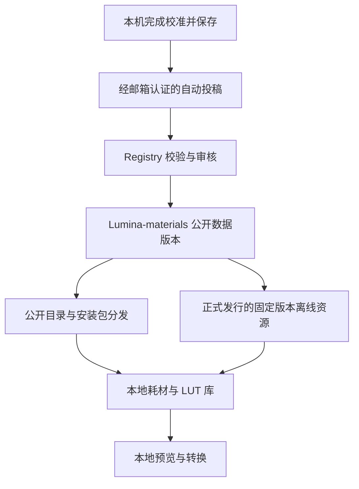

# Lumina 耗材与 LUT 开放数据及自动贡献方案

2026-11-16 修订：默认分发改为**源码读 GitHub 快照、打包版读官方实时目录**，旧的“相同默认源”设计由[资源分发](../resource-distribution.md)替代。数据继续公开，社区账号共用；官方云的赞助权益校验仍需接入启动器激活后端，不能把默认地址当作权限证明。

2026-11-17 实施进度：本文保留最初的设计依据，接口名称和实施状态以[社区账号与投稿](../resource-contributions.md)、[资源分发](../resource-distribution.md)为准。邮箱验证码、设备授权、自动贡献队列、邮箱变更与人工恢复已在本地实现。桌面连接沿用浏览器核对连接码／客户端轮询方式；反馈交给维护者处理，不提供用户之间的联系方式。正式部署、打包适配和历史数据整理另行验收。

日期：2026-11-05。更新：2026-11-06，补充空库指引，核对现有 Registry 登录及本地正式包，统一账号复用、打包资源与跨版本贡献流程。状态：设计方案，实施范围覆盖主应用、内容仓库、Registry 与正式发行流水线。

Lumina 将耗材档案、生产 LUT 和配套资源从软件源码仓库迁出，由独立公开数据仓库维护。所有人均可免登录获取已发布数据；正式打包版沿用已有公共连接和离线资源装配能力，补齐 LUT 种子与空库指引。贡献身份统一使用现有耗材服务器账号，为其增加邮箱验证码登录；用户确认开放贡献并授权本机后，软件自动提交其新生成的校准资料，经过校验和审核再公开发布。

本方案确定产品行为、数据归属、系统分工、接口边界和实施顺序。实现与部署在后续任务执行；文中的新增接口和模块均为实施目标。

## 已确定的产品决策

| 事项 | 决策 |
| --- | --- |
| 数据开放 | 已发布的耗材档案、LUT、允许公开的校准数据和版本记录全部公开，可独立下载和复用。 |
| 访问资格 | 公共数据的浏览、下载与本地使用不要求账号或赞助资格。 |
| 厂家合作 | 通过合作厂家展示、资源入口和校准贡献署名体现；合作关系与数据质量分别标注。 |
| 主应用仓库 | 保留功能代码、格式定义、文档和必要测试样本，移出生产数据全集及配套大图。 |
| 打包版 | 复用现有发行适配，保留公共连接、固定版本离线资源和已有用户目录，在创作软件中提供自动贡献入口。 |
| 源码运行 | 默认使用 GitHub 公开快照，可自行准备公开离线包；投稿与互动共用社区账号，保留自部署配置能力。 |
| 贡献身份 | 复用 Registry 现有账号、用户编号和投稿归属，增加邮箱验证码登录；已有密码和 GitHub 登录保留，不另建账号服务。 |
| 启动器与贡献 | 启动器激活继续负责软件权益；创作软件连接耗材账号用于投稿署名。公开数据不受激活、赞助或贡献登录限制。 |
| 自动贡献 | 首次验证邮箱并确认开放用途后，对今后由本人新校准生成的资料自动投稿。 |
| 数据发布 | 投稿先进入待审核区，校验和审核通过后才进入公开数据集。 |
| 本地工作 | 校准、保存、转换和已安装资源的使用不依赖在线服务。 |
| 空库体验 | 将没有耗材档案或 LUT 作为正常状态，提供获取、导入与校准入口，按当前工作模式补齐所需资源。 |

“自动贡献”是向公共数据集投稿。首次启用时明确说明公开用途，后续符合范围的新资料无需逐份确认。既有本地库和外部导入文件不因打开此功能而被扫描上传。

## 当前基础与迁移依据

主分支已通过 [PR 282](https://github.com/lumina-layer-studio/Lumina-Layers/pull/282) 移除 182 份耗材档案。当前工作树可能早于该提交，实施时先确认基线，保留本地已有数据。

前期核对的主分支预设目录包含 67 个 LUT 文件，其内容在独立内容仓库均能找到对应版本；该目录约 70 MB，其中 LUT 约 13 MB，色卡和照片约 57 MB。线上只读目录在 2026-11-05 的观察结果为 682 条耗材和 136 条 LUT，数量高于内容仓库现有集合。迁移必须比较具体标识、版本、文件内容和来源，不能用条目数量相近代替覆盖检查。

[Lumina-materials](https://github.com/lumina-layer-studio/Lumina-materials/blob/master/README.md) 已有耗材源、LUT 源、单资源安装包与种子包构建脚本。目前文档规定种子包仅含 official 资源，现有 LUT 集合位于 community，尚无可直接采用的正式 LUT 种子包。入门候选须完成官方复核后再进入正式种子包。

主应用已有耗材与 LUT 的目录读取、下载校验、本地安装和同步索引；Registry 已有身份、投稿、审核、发布和审计能力。邮箱验证码、桌面投稿凭据、自动贡献队列及公开数据仓库发布衔接需要补齐。

2026-11-06 补充核对了「接手打包工作」聊天的发布记录，以及本地保留的 Windows、macOS `2.0.1-nightly.20261104175403` 完整包。记录中的本体来源为 `1308c06fc69915e11ead7dbefa0c1e7da11504d0`，Distribution 来源为 `8339765013942c86d1f264a2c732985d5cfccd99`。两个包都包含 174 份耗材的种子包，大小为 1,157,734 字节，种子清单标记为 official；包内也仍有生产 LUT。这里确认的是归档包内容与发行来源，既有 official 标记仍须接受本方案的来源核对。

对应发行代码的 `official-runtime.cjs` 已注入公共耗材连接，LUT 可沿用耗材连接回退；同时默认关闭启动和定时全量同步。`managed-runtime.cjs` 已将耗材、Custom LUT、Cloud LUT 放入跨版本共享目录，附加实例有独立设置与 Electron 用户目录。因而源码运行、正式包与启动器需要分别核对，不能把源码里没有默认配置理解为正式包也没有。[该发行版本的运行适配](https://github.com/lumina-layer-studio/Lumina-Distribution/blob/8339765013942c86d1f264a2c732985d5cfccd99/studio-overlay/electron/official-runtime.cjs)、[共享资料与实例路径](https://github.com/lumina-layer-studio/Lumina-Distribution/blob/8339765013942c86d1f264a2c732985d5cfccd99/studio-overlay/electron/managed-runtime.cjs)

## 仓库分工与发布路径

| 所属位置 | 职责与权威数据 |
| --- | --- |
| 主应用仓库 | 本地校准与转换、资源管理界面、下载和贡献客户端、必要测试样本。 |
| Lumina-materials | 公开发布数据的权威内容版本：源文件、公开校准资料、署名、许可、数据集版本、入门包定义，以及版本附件的引用。 |
| Lumina-material-registry | 私有联系信息、认证凭据、待审稿件、审核决定、发布操作记录，以及公开目录和包的分发服务。服务代码是否公开不影响数据开放。 |
| 正式发行流水线 | 固定应用版本和数据版本，在构建时取得入门包并装入发行资源层。 |
| Lumina-Launcher | 继续管理设备激活、离线权益回执、程序版本、下载和启动；向创作软件传递受管理资料位置与实例信息。 |

复用现有内容仓库，不另建一套平行的数据仓库。现有私有仓库对外公开前，先核对发布内容、历史中的凭据及个人信息和开放授权；这一操作在迁移阶段执行。

Git 保存适合版本管理的源文件、元数据和构建脚本；安装 ZIP、种子包、大图及较大的源文件作为对应数据版本的公开 Release 附件发布，再同步到现有下载位置。内容版本明确引用附件及其校验信息，全部文件均可匿名获取，避免把每次构建的二进制副本重复写进 Git。已有包文件历史保留，新增产物按这一规则存放。[GitHub 版本与附件发布](https://docs.github.com/en/repositories/releasing-projects-on-github/about-releases)

Registry 负责一次发布操作的推进：冻结已审核输入，构建并校验包，写入公开内容仓库的确定版本，将相同文件同步到下载位置，最后激活公开目录。公开目录必须关联内容仓库提交、数据集版本和资源版本。

沿用现有发布操作记录做重试和恢复，不再引入独立工作流服务。GitHub 写入失败、包未就绪或校验失败时，继续提供上一个有效目录；待发布条目保留在原发布操作中重试。仅当公开仓库和下载内容均就绪时，才标记发布成功。

GitHub 上的维护者修订也进入同一校验、审核和发布路径。业务审核决定归 Registry，已发布文件归内容仓库；客户端和镜像不产生第二套独立内容。

## 公开范围与许可

新贡献数据建议统一采用 CC BY 4.0：允许复制、修改、再分发和商业使用，保留合理署名、许可链接及修改说明。公开首版同时提供完整许可文本、贡献说明和机器可读许可字段；软件代码继续使用各自既有许可。[CC BY 4.0 条款摘要](https://creativecommons.org/licenses/by/4.0/deed.en)

历史第三方资源保留已有许可和来源。只有确认有权开放的数据才进入公开发布；授权尚待确认的资料保存在迁移待处理区，逐项补齐。历史作者不明时如实记录，不编造作者或认领关系。

厂家 Logo 和商标按各自授权使用，资源中的合作标识不扩大其商标授权范围。

| 公开发布 | 留在服务端或本机 |
| --- | --- |
| 耗材档案、拟合参数、LUT、相关数值采样及必要处理参数 | 邮箱、验证码、设备投稿凭据和管理凭据 |
| 公开贡献者编号、署名、来源、校准方法、版本关系和审核结论 | 未发布投稿、身份申诉资料、私有审核交流和运维日志 |
| 已选择公开的色卡、说明和经过处理的校准图片 | 未选择公开的原始照片、图片定位信息、本机路径和电脑用户名 |

自动贡献默认提交校准数值与必要参数。原始照片的公开作为单独选择，先去除 EXIF 等与校准无关的信息。用户的转换图片、模型、输出工程和使用记录不属于自动贡献范围。

关闭贡献停止后续自动上传，可撤回尚未发布的投稿。已按开放许可发布的数据通过更正、版本标记或目录下架处理；不能把关闭开关解释成撤销所有人的既有许可。[CC BY 4.0 完整条款](https://creativecommons.org/licenses/by/4.0/legalcode.en)

## 资源获取与正式打包版

### 默认公共连接

正式版读取官方 HTTPS 实时源，源码读取 GitHub 静态目录。目录和安装包保持同源，沿用现有包校验与本地资源身份；静态目录在本机适配为分页和检索响应，不遍历 GitHub API。

第一版沿用正式包已配置的公开只读镜像及 Registry 只读端点契约，减少客户端适配和新增服务。Registry 发布后的目录与包同步到镜像，激活对应目录前确认文件就绪。不能将 GitHub Release 重定向链接直接替换到现有安装器，或为接入镜像而整体关闭同源和重定向检查。

2026-11-06 的无登录只读请求确认：正式包主地址的首页标明“Lumina 公开耗材只读镜像”，耗材目录可返回 200，而 `/auth/session` 与 `/auth/github/config` 返回 404。它是读取入口，不能在该地址后直接拼接登录或投稿路径。此轮 Registry 源站请求超时，登录实现已通过固定 Registry 代码版本核对，部署联调须另验实际可达性。[现有公开只读镜像](https://materials.luminastudio.com.cn/)

客户端明确区分公开读取地址与 Registry 的账号／投稿地址，默认值由维护者配置，用户界面仍呈现一个资源中心。账号授权始终指向已确定的 Registry 来源；读取镜像的失败回退不携带或转发贡献凭据，也不自动改变投稿目标。服务切换需要重新确认对应账号，不能仅凭某个下载目录提供的新地址迁移授权。这样既复用现有镜像，也让同一套耗材账号覆盖网页和本体。

公共目录和下载请求不携带贡献凭据。自备 Registry 的读取凭据只发送到用户明确配置的对应地址；上传凭据与读取配置分别管理。显式关闭云端、覆盖服务地址等现有配置能力继续保留。

首次进入资源中心自动读取目录。默认定时检查目录和已安装资源的新版本，沿用有条件请求和本地状态检查；资源下载由安装操作或明确开启的更新选项触发。

当前 api/material_sync_scheduler.py 会调用完整安装同步。启用默认公共地址前，将默认调度改为只检查目录和更新提示；既有手工全量同步入口保留原有契约。不能通过配置一个默认 URL 就让新用户自动安装整个远端材料库。

### 随正式包提供的离线资源

正式发行附带经过复核、兼容条件完整的离线资源包。现有 174 份耗材合计压缩后约 1.1 MiB，优先保留其中授权和来源已核实的覆盖范围，无需为了迁出源码就缩成几份示例。LUT 整理为独立种子，以现有正式包资源为兼容迁移依据，覆盖常用颜色模式和配色；原始大图按需获取。厂家展示优先满足设备、材料类型、层高和配色兼容，再呈现合作推荐。

入门包在 Lumina-materials 定义和构建，发行流水线固定数据版本后取得；主应用 Git 不保存生产数据全集，也不为每次数据更新重发应用。耗材包和 LUT 包沿用各自格式，由同一入门集记录关联。

随包目录列出资源标识、版本、名称和预览资料。用户点击单个耗材或 LUT 后，按其资源标识和修订读取对应文件、校验并登记到本地。重复选择同一修订沿用原记录。

软件启动时只读取各自的本地库。新用户可以断网浏览随包目录，按需添加一份；已有用户从现有资料继续工作。源码用户可以下载同一版本的离线包供挑选。

现有 Distribution 已有 `stage_desktop_material_seed.py`、种子锁文件和正式包资源路径，实施时沿用其校验与装配契约，把数据来源改为公开内容仓库的固定版本，并补充 LUT 等价流程。公开数据包本身始终可独立获取，不要求先取得正式软件安装包。现有完整包同时含后端 assets 和发行 resources 两处耗材种子；迁移时核对读取者，再由打包清单消除不需要的重复副本，不能直接删除仍有读取者的资源。

### 与启动器、正式本体和用户资料衔接

启动器激活并安装本体，正式包内的离线资料可供用户预览和单项添加。需要贡献时，在本体内连接耗材账号并授权一次，后续由本体完成已授权的自动投稿。公共目录、下载、离线使用和空库指引均可独立于贡献登录使用。

| 现有部分 | 本方案的衔接 |
| --- | --- |
| Tauri 启动器的安装 ID、权益回执、维护凭据 | 保留其设备与下载职责；这些信息不能替代校准作者，一个订单下的设备可能由不同人使用。 |
| Registry 用户、网页登录和投稿记录 | 作为唯一的贡献身份来源；邮箱验证码、密码和 GitHub 是同一账号的不同入口。 |
| Electron 创作软件及本机后端 | 提供连接账号、查看状态、贡献设置和保存后投稿；只持有该账号授予当前工作区的贡献权限。 |
| Distribution 发行适配 | 装入固定版本离线资源，注入公共默认地址及受管理存储位置，适配正式包中的账号连接入口。 |

本体不读取启动器的维护 token，也不向耗材服务器提交订单号、激活码或离线回执来自动认领作者。未来若需要在个人资料里展示已关联权益，再通过双方已验证的身份显式关联；首版不以跨服务账号合并作为数据开放和投稿的前置工程。

耗材与 LUT 延续现有共享位置，包括 `shared-data/materials`、`shared-data/luts/Custom` 和 `shared-data/luts/Cloud_sync`。资源锁和安装记录绑定共享库；用户主动删空后，下次启动仍展示获取指引。

贡献身份、确认记录和队列绑定现有实例工作区：主工作区使用共享根，附加工作区沿用 `instances/<id>`；在工作区内按 Registry 来源和用户编号隔离。队列存入持久资料位置，不放进 `versions/<build>`、`derived/<build>` 或临时会话目录。同一工作区切换稳定版、内测版后沿用已有授权与回执；同一队列仅由取得锁的兼容进程处理，服务端仍执行幂等去重。附加工作区首次创建时只可沿用普通偏好，不复制贡献凭据、已启用标志或旧队列；现有复制 `user_settings.json` 的路径必须对此做明确处理。

长期贡献授权由本体主进程通过操作系统保护能力保存，凭据命名绑定工作区、服务来源和账号，不绑定程序版本或安装 ZIP 路径。网页只得到公开连接状态；本机后端通过受保护通道取得短期投稿凭据。浏览器 Session 与启动器凭据均不复制到本体。注销耗材账号只停止其投稿，不解绑启动器，不删公共资源；切回不支持贡献功能的旧本体仍可本地创作，不修改较新队列结构。

公共默认连接以现有正式包配置为基线，保持显式关闭和自定义地址有效。源码和正式包复用主应用的目录、下载及贡献逻辑，Distribution 只做资源和运行环境适配。若现有启动器协议已经满足路径和实例传递，本轮无需为了贡献功能强制升级小启动器。

### 一个资源中心

资源中心以“已安装”和“发现资源”为主要入口，提供耗材档案与 LUT 类型筛选、品牌、材料、色组、层高、校准方法和更新状态。两个资源类型继续使用各自业务模型与校验，界面不要求用户理解部署拓扑。

下载后沿用现有本地选择、详情、预览和转换流程。LUT 不替代耗材档案，也不把两者改成同一种文件。合作厂家标识、厂家身份确认、数据质量审核分别展示。

资源详情显示原作者、投稿者、来源、版本和问题反馈入口。“我的贡献”显示投稿进度、审核意见与撤回操作；“贡献设置”管理联系邮箱、公开署名、自动投稿和设备授权。

### 空库指引与首次取得资源

空库指引属于迁出的必要交付，在移除剩余生产 LUT 前完成。源码首次运行、用户主动清空、入门包安装失败，以及有资料但当前模式没有适用项，都需要明确的下一步。

指引放在本地资源库和转换选择器。只缺耗材时可以直接去找手里那盘料的档案，只缺 LUT 时可以去核对实际配色；有离线包时两个入口都能打开对应的随包目录。

#### 三条取得资源的路径

| 入口 | 耗材档案为空 | LUT 为空 |
| --- | --- | --- |
| 主操作 | “查找耗材档案”：进入公开目录，按已知材料、层高等条件筛选。 | “查找 LUT”：进入公开目录，按当前颜色模式、配色等条件筛选。 |
| 次操作 | “导入本地档案”：复用已有档案导入流程。 | “导入本地 LUT”：保留 .npy、带键 .json、.npz、.msgpack 支持。 |
| 辅助入口 | “自己校准”：进入梯度卡生成、打印、提取及保存的对应流程。 | “自己校准”：进入适用色卡生成、打印、提取及保存的对应流程。 |

主操作旁说明“公开资源可直接下载，无需登录”。“自己校准”让用户选择从生成校准卡开始，或继续提取已有色卡；不能要求先拥有耗材档案或 LUT 才能创建第一份资料。邮箱验证只在用户启用贡献时出现。

资源库使用一块简洁指引：标题、用途说明、一个主按钮及两个次级入口。选择器使用紧凑版本，保持当前工作面。示例文案为：“还没有耗材档案。添加与你实际使用的耗材相符的校准档案，即可在转换时选择。”和“还没有 LUT。添加符合当前颜色模式和实际配色的 LUT，即可继续转换。”只在依赖该资源的流程中使用后一句，不把两类资源都设成所有模式的前置条件。

目录使用品牌中英文名、已有标志、地区包装名称和色号帮助用户识别产品。地区名称须有商品资料或提交者提供的对应关系；缺少这些资料时保留原名。界面语言与包装地区可独立设置，检索可以使用任一已知别名。合作身份与产品兼容性分别展示。

#### 区分空库、未选择与暂时不可用

| 实际状态 | 界面处理 |
| --- | --- |
| 本地目录尚未读完 | 显示加载进度，读取成功后才判断是否为空。 |
| 本地读取成功，确实没有资料 | 显示上述三条取得资源的路径。仅缺一类时不要求重建另一类库。 |
| 本地已有可用资料，但当前未选择 | 提示选择现有资源；不进入首次获取指引。 |
| 搜索、品牌或收藏筛选没有结果 | 提示当前筛选无结果，提供清除搜索、重置可选筛选或查看全部；不说整个库为空。 |
| 有资料，但不符合当前模式、层高或配色要求 | 说明具体不匹配条件，提供查找适用资源或调整工作参数的入口；不绕过必要的兼容校验。 |
| 本地目录读取失败，或文件损坏 | 显示读取失败及重试或修复入口；仍可列出已成功读取的资料，不把失败解释成零资源。 |
| 公共目录连接失败或处于离线状态 | 保留本地资料与可用的目录缓存，并说明状态；空库时优先展示实际可用的离线入门包或本地导入，恢复联网后可重试。 |
| 用户显式关闭公共连接 | 保留导入与校准，提供主动开启公共资源的入口；不自动开启，也不反复发起连接。 |
| 旧项目引用的资源缺失 | 显示缺失资源及版本，按确定的来源获取对应版本或导入匹配文件；替换成其他资源须由用户明确选择。 |

本地库、公共连接和筛选结果分别判断。已有本地资源时，云端故障不遮住资源列表；已有完整缓存目录时注明离线缓存，不能把未下载的远端包显示成可离线安装。兼容信息缺失的候选显示缺失项，不标记为已确认兼容。

耗材选择器当前已区分加载、读取失败、空库、空收藏和筛选无结果，可沿用其判断补齐操作。耗材库现有空提示主要让用户自行跳转到提取页面；LUT 库当前共用筛选后的空列表提示，实施时补齐状态区分和直接获取资源的操作。

#### 取得资源后回到原任务

从选择器进入公开目录时，保留当前图片、参数、已有选择和返回位置，并携带资源类型及已知兼容条件。目录同时提供“安装”和“安装并使用”；后者仅在安装校验成功且符合当前任务条件时应用，返回原选择位置。多选模式保留已有选择，不用新下载项替换整组选项。

本地导入或自行校准保存成功后，也提供“用于当前任务”。若用户在下载期间切换了模式、项目或编辑上下文，完成后重新检查目标，显示“已安装”并让用户决定是否使用，不自动改写新任务。取消、网络失败、导入失败或校准中断均可返回原工作，不清空图片与参数。

未取得必需资源时，界面在相关操作旁显示原因和获取入口，阻止依赖该资源的预览或生成；与该资源无关的操作照常可用。空库可以正常启动，目录读取返回真实空结果，提交缺少必需资源的转换请求时仍由后端校验并给出可处理错误。运行时不生成空 LUT、全零表、占位耗材或假配方来绕过校验，也不在资源缺失时静默选用其他厂家数据。

#### 随包目录与单项安装

软件预览随包目录时只读清单。用户选择一项后，校验该项的资源标识、修订与内容，安装到与云端下载共用的本地库，并显示刚添加的名称。

用户删除全部资源后，下次启动继续展示空库指引。重新取得资源仍从云端或随包目录按项选择。两类库各自处理，安装耗材时不会把其他耗材或 LUT 一起装入。

界面沿用 DESIGN.md 的共享控件、主题、键盘焦点与单一主操作层级；所有新增文案进入 frontend/src/i18n/translations.ts，覆盖现有支持语言。复用同一套获取与返回行为，避免资源库和转换选择器形成两套下载流程。

## 邮箱认证与可追溯身份

### 复用耗材服务器已有登录

2026-11-06 核对的 Registry 代码版本 `4e2ed690bbd806001cd71085798383687ba50007` 已有 `users`、`user_roles`、`sessions`，邮箱密码登录、邀请注册和可选 GitHub 登录；耗材投稿绑定 `owner_user_id`，LUT 投稿从登录上下文写入 `submitted_by_user_id`。网页已有登录弹窗、个人投稿和角色判断。新增能力直接接入这套账号及投稿服务，不另建贡献者账号数据库或独立身份服务。[现有登录接口](https://github.com/lumina-layer-studio/Lumina-material-registry/blob/4e2ed690bbd806001cd71085798383687ba50007/registry_service/routes/auth.py)、[身份与会话实现](https://github.com/lumina-layer-studio/Lumina-material-registry/blob/4e2ed690bbd806001cd71085798383687ba50007/registry_service/identity.py)

本次新增的核心是现有账号的邮箱验证码入口，以及该账号授权桌面投稿的能力。网页与软件使用同一身份、署名及投稿历史；软件通过服务器登录页连接账号，维护登录与找回流程只需一处。原密码、邀请与 GitHub 流程保留，新用户不必先取得 GitHub 账号或设置密码。

### 首次启用

用户在本体点击“连接耗材账号”，打开系统浏览器中的耗材服务器登录与授权页。已有有效登录且联系邮箱已验证时，直接确认当前署名和“允许这台设备贡献”；未登录时，默认提供邮箱验证码，密码与 GitHub 作为已有方式保留。新用户验证邮箱后自动建立普通账号，无需邀请码或单独填写注册表。QQ 邮箱、163 邮箱和其他正常邮箱采用相同流程。

同一授权页显示将使用的账号与公开署名，允许切换账号，并说明开放用途和自动贡献范围。确认后软件取得受限设备授权并显示“已连接”；启用自动贡献的选择单独留存。只下载或本地校准的用户可以跳过，不反复弹出登录。

建议界面说明为：“将今后在本机新校准生成的耗材档案与 LUT 自动提交到公共数据集。审核通过后公开发布，保留你的贡献署名。联系邮箱仅用于身份验证及维护者联系。”

邮箱验证与开放贡献确认分别记录；一次确认覆盖之后符合范围的自动投稿，不覆盖既有文件扫描、第三方代传或原始照片公开。未完成验证或确认时，本地功能照常使用，自动上传保持未启用。

### 身份归属

复用 Registry 的现有 `user_id`、`display_name`、角色与 Principal 身份映射。公开贡献者视图以现有稳定用户编号作为 `contributor_id`，不再建立平行账号或额外编号体系；新增邮箱验证事实、设备授权及开放贡献确认记录。昵称、启动器安装 ID 或文件中自带的作者字段均不能作为认证依据。

旧账号沿用原 `user_id`、密码、GitHub 绑定及历史投稿。当前密码注册本身没有邮箱验证码校验，数据库也没有足以直接视为本次邮箱认证完成的统一事实，不能批量把旧邮箱标成已验证。旧账号首次启用新入口时，先用原密码、已绑定 GitHub 或仍有效的原会话确认账号，再验证联系邮箱并启用验证码登录；已有明确可信验证记录的账号可复用该事实。仅拿到与旧档案相同邮箱的验证码，不自动合并未完成绑定的旧账号。联系邮箱变化按后文恢复流程处理。

新建的跨登录方式绑定执行同一账号归属检查，避免另一个登录入口绕过旧账号绑定规则；既有已绑定 GitHub ID 继续登录原账号，不搬移历史数据。改为邮箱验证码不会自动解除 GitHub 绑定或关闭已设置的密码。

新建账号仅授予 `user`，沿用现有密码登录开关禁用未设置的密码登录，不生成或发送临时密码。验证码自助入口不消费管理员邀请，也不继承邀请、厂家或审核权限；现有邀请流程继续承担其原有职责。

服务器从认证上下文生成投稿者身份；请求体中伪造 contributor_id、投稿者、审核者或权限字段时拒绝处理。原作者认领和厂家认证由独立审核确认，认证标志也由服务端产生。

账号与角色共用，认证方式和授权范围分别记录。邮箱验证码会话及桌面授权只具备普通贡献和必要的本人资料能力；即使账号已有管理员或维护者角色，也不能只凭该会话进入管理操作。管理操作沿用原有认证要求，服务端在统一权限边界检查有效权限，网页显示对应范围；设备投稿凭据始终不能调用审核、发布、角色修改或他人投稿接口。

| 身份概念 | 处理规则 |
| --- | --- |
| 公开署名 | 可以修改、允许重名，始终与稳定贡献者编号关联。 |
| 联系邮箱 | 服务器确认收件控制权后保存，维护者按授权联系，公开目录与数据仓库不导出。 |
| 原作者 | 自行校准者默认关联本人；代传保留原作者线索，不能凭填名字绑定他人的认证作者档案。 |
| 投稿者 | 服务器记录实际认证提交者，与原作者分开。 |
| 厂家身份 | 维护者通过已有厂家联系核对，邮箱域名或昵称相似不能自动获得认证。 |
| 审核者 | 来自管理端权限，保留具体审核操作和结论。 |

邮箱建立可联系的投稿归属，原始校准资料和审核支撑作者及数据来源判断。确认邮箱不自动证明真实姓名、厂家归属或数据真实性。

### 验证与设备授权

当前实施采用系统浏览器核对十位连接码、网页明确允许、Studio 轮询确认的方式，复用服务器登录会话。随机连接凭据保存在客户端后端内存，网页只显示连接码；批准后的临时凭据由具备安全存储的桌面端换成设备授权。长期凭据不放在跳转链接中，浏览器登录状态不会直接变成桌面凭据。早期提议的 PKCE 回调暂不实施。

当前实现参数：验证码 6 位、10 分钟有效、每个挑战最多尝试 5 次、60 秒后可重发；每邮箱每小时最多发送 5 次，每 IP 每小时最多 20 次，全局每小时最多 200 次。验证码随机生成、绑定邮箱和用途、一次性消费，重发使旧码失效。限流保存在数据库，重启不重置。

验证码仅保存由服务端密钥保护的校验值；验证码、授权原文和完整联系邮箱不进入常规日志或公开错误。沿用既有邮箱唯一约束，不自行合并带点号、加号或不同域名的邮箱。

设备授权使用不可预测的随机凭据，服务端保存校验值、归属、有效期和撤销记录。建议短期访问凭据有效 1 小时，设备续期凭据 90 天不活跃失效，最长 365 天重新验证；续期进行事务化轮换并由客户端统一处理。用户可在网页账号页或本体“贡献设置”撤销本机或全部设备授权，两处读取同一服务记录。保留现有网页会话生命周期，网页退出和撤销设备分别表达，避免一次退出意外停掉其他已授权工作区。

桌面端长期凭据放入系统凭据库或 Electron 安全存储；仅在实际具备保护能力时开启长期保存。前端 localStorage、共享设置、分享卡和日志只保存公开状态，不保存授权原文。源码模式缺少安全凭据存储时支持本次会话认证，不静默降级为明文长期保存。

更换邮箱需确认旧、新邮箱，保留贡献者编号和操作记录。旧邮箱不可用时走维护者恢复审核，不能仅凭公开昵称或可下载的数据文件认领。姓名和联系信息的变更不重写历史投稿归属。[OWASP 身份验证与敏感变更](https://cheatsheetseries.owasp.org/cheatsheets/Authentication_Cheat_Sheet.html)

邮件通道由服务端配置并验证发信域名。上线前使用真实 QQ、163 等收件箱验证送达和重发体验；自动测试的模拟发送不替代此验收。

## 自动贡献的范围与队列

| 触发情形 | 默认行为 |
| --- | --- |
| 本人完成新校准，成功保存耗材档案 | 创建该次保存的不可变投稿快照，后台提交。 |
| 本人完成色卡提取并保存最终 LUT | 提交 LUT 与校准条件；只有临时预览或提取未完成时不提交。 |
| 对自己的校准资料重新测量或修改 | 建立新版本并关联上一个资源或投稿版本。 |
| 仅改昵称、使用次数、排序、预览缓存或文件时间 | 不产生新的数据投稿。 |
| 从公共源下载、初始化入门包 | 保留来源，不回传成自己的新贡献。 |
| 导入第三方资源、历史文件或合并他人 LUT | 提供手动贡献与来源说明，自动贡献不替其声明作者。 |
| 修改已下载资源 | 作为派生贡献提交，保留基础资源版本；由审核决定关系，不改写他人的作者归属。 |

一次校准生成的耗材档案和 LUT 通过同一个贡献关联标识连接，底层分别使用现有耗材包和“一包一 LUT”格式。不要求每次贡献同时拥有两类数据，不为自动投稿改变现有 LUT 文件格式。

本地保存成功后，API 编排层调用投稿快照能力并入队；转换和校准核心不执行远端网络请求。每个工作区的队列由一个取得锁的后台调度器管理，前端只展示状态和发起重试、暂停、撤回请求。触发依据是本实例完成保存的业务事件，不扫描共享耗材目录来推测谁创建了文件。

快照保存最终技术数据、必要校准参数、来源关系、应用与生成器版本、许可确认版本及内容摘要。快照与预览临时文件、转换会话分开持有；关闭原会话、修改本地文件或重启软件均不改变已排队的版本。

本地状态以“待上传、云端已接收、需处理”为主，重试时间和具体原因作为字段记录；待审核、已发布、需补充等审核事实以服务端为准。客户端不维护另一套审核状态机。

提交带稳定幂等键。同一快照重复请求返回同一投稿；请求超时后可安全重试。云端相同内容可复用文件存储，但不同贡献者的来源声明、许可和争议记录分别保留，不因文件相同自动转移作者。

耗材投稿沿用“创建草稿再提交审核”的既有两步过程，两步使用持久化回执恢复；LUT 投稿沿用现有上传即进入 pending 的行为。关联的两份投稿分别记录回执，重试不再上传已被接收的部分。

网络失败采用有上限的退避重试；认证失效暂停上传并提示重新验证，格式问题和服务端拒收显示具体原因。任何上传失败都不撤销已经成功的本地保存，也不阻塞转换。

关闭贡献时暂停未开始的任务；进行中的请求查询并显示实际回执，已经被云端接收的投稿按撤回流程处理。切换贡献身份时保留原队列归属，原身份任务暂停，不能转记到新身份。再次开启不会补扫既有文件，用户可明确恢复原队列或逐项取消。

初始队列磁盘预算为同一受管理资料根合计 512 MiB、最多 100 个未完成快照，先到者生效，不因增加实例而复制预算；达到预算时暂停新增快照并显示待处理项目，保留原始本地业务文件。可重试项目不静默删除，成功取得云端持久化回执后释放可重建上传快照，保留轻量状态和来源索引。任务或软件退出时取消本进程调度任务，下一次启动继续。

## 校验审核与公开发布

服务端沿用现有 ZIP 路径、解压大小、清单、文件摘要、资源格式和内容可加载性校验。新增自动贡献只接入现有业务能力，不另写一套 LUT 或材料解析器。

保留并接入现有按贡献者计算的投稿次数、文件大小和累计存储配额，格式无效的尝试也计入请求限额；暂停某个贡献者的权限不影响其他人下载公开数据。

审核至少检查以下内容：

- 材料型号、品牌、颜色、层高、色组和校准方式是否可识别，拟合参数、采样值与声明是否一致。
- LUT 的 RGB、配方、材料通道、底色通道、层序和元数据是否一致，保留现有所有格式和缺失配方修复规则。
- 原作者、实际投稿者、派生来源和许可是否正确，声明他人或厂家身份时是否已有确认。
- 同内容、同逻辑路径和不同版本是否重复或冲突；冲突给出明确处理，不按文件名或排序猜最新版。
- 公开文件与图片是否包含邮箱、授权、机器绝对路径或其他非公开内容。

第一版所有新公开贡献均须审核。已确认厂家身份与数据质量审核分别处理。存在问题时可要求补充、拒收、暂停贡献身份、发布更正版或下架问题版本；操作留痕，不删除历史投稿来掩盖变更。

公开导出采用字段白名单，至少包含资源类型、material_id 或 lut_id、revision_id、现有内容与包校验字段、兼容条件、作者与投稿者公开编号、来源、许可、审核结论和公开数据版本。复用现有清单字段的定义，不重定义 content_hash 的算法和语义。

现有 registry_service/identity.py 的 Principal.public_dict() 包含邮箱，不能直接作为公开作者导出对象。身份联系视图和公开贡献者视图分别输出，公开包、目录、Git 提交作者信息和发布日志均检查邮箱外泄。自动写入内容仓库使用维护者配置的机器人身份，贡献者署名保存在公开资源元数据中。

公开目录下架保留问题版本的来源与纠正记录。已安装资源提示更新或问题信息，避免静默更换已保存项目引用的数据；审计和历史包按服务端保留规则管理。

## 资源标识与兼容

继续使用 material_id、lut_id、revision_id 和既有内容摘要，名称与磁盘路径只作展示及定位。公开数据集版本引用确定的资源版本；同一次校准的关联关系单独记录，不把资源 ID 改成作者昵称或本机路径。

正式版的可写材料、Cloud LUT、Custom LUT 和同步索引放在用户数据目录，沿用已有绝对目录覆盖能力。只读发行资源只承载种子和版本信息，用户修改不写回安装目录。

已安装旧文件不因源码迁出而被删除。需要迁移实际文件时先保护原内容，校验新位置可用后更新引用；记录旧逻辑路径与相同内容的映射。同名但不同内容不自动覆盖或合并，旧项目遇到歧义时要求选择确定资源。

保留 LUT 的 .npy、keyed .json、.npz、.msgpack，以及真实配方、材料身份、颜色模式别名、底色通道和层序语义。保留用户已保存的历史合并 LUT，新的多 LUT 选择继续沿用运行时组合流程。

必要测试样本留在 tests/fixtures，和公开内容仓库的大集合分开维护。生产数据迁出不能让常规测试依赖联网，也不能更换既有性能历史基线来掩盖变化。引用生产预设的脚本改用显式资源参数或已固定的必要样本。

## 接口与实现落点

### Registry 接口

以下路径均相对于现有 /api/material-registry/v1；新增接口名称为目标契约。身份与投稿接口请求已配置的 Registry 账号来源，公共镜像只承载其声明支持的读取路径。

| 接口 | 状态 | 责任 |
| --- | --- | --- |
| /auth/register、/auth/login、/auth/session、/auth/logout 及 /auth/github/* | 复用 | 保留旧账号登录与邀请入口；统一呈现会话认证方式、有效权限与当前身份。 |
| POST /auth/email/challenges | 新增 | 请求邮箱验证码，返回挑战标识与重发等待信息。 |
| POST /auth/email/verify | 新增 | 一次性消费挑战，完成现有账号的邮箱验证与受限网页登录；遵循旧账号绑定规则。 |
| GET、POST /auth/authorize | 新增 | 在现有网页登录页完成本机贡献授权，检查会话、CSRF 与许可确认后签发一次性授权码。 |
| POST /auth/token | 新增 | 用授权码和 PKCE 证明交换设备凭据，或轮换续期授权取得短期投稿凭据。 |
| GET /auth/devices | 新增 | 查询本账号已授权设备与工作区，供网页和本体共用。 |
| POST /auth/devices/revoke | 新增 | 撤销当前设备或经重新验证后撤销全部设备。 |
| GET /me/contributor 与 PATCH /me/contributor | 新增视图 | 读取和修改现有账号的公开署名等本人资料，联系信息变更单独验证；不建立另一套用户。 |
| /me/material-submissions 及其明细、submit 路径 | 复用并扩展认证 | 创建、补充、查询、撤回本人材料投稿，并显式提交审核。 |
| /me/lut-submissions | 复用并补齐本人明细与撤回 | 提交 LUT，查询服务端回执和审核状态。 |
| /materials/catalog、/packages、/luts/catalog、/luts/packages | 保留读取契约 | 无需投稿授权读取公开发布资源。 |

在统一认证边界将浏览器 Session 和受限设备授权解析为同一身份语义，分别执行 Cookie 的 CSRF 要求与设备授权范围检查；不在每个路由复制解析逻辑，也不放宽现有管理端权限。

### 文件与能力分工

表中的“新增”是能力落点建议，实施时可在相同职责的既有模块中实现，避免重复基础设施。

| 位置 | 主要改动 |
| --- | --- |
| 主应用 api/services/lut_registry_sync.py、api/routers/lut_registry.py、core/single_stage/material_sync.py、api/routers/material_sync.py | 公共默认连接、公开目录元数据、安装与来源兼容；保持下载校验。 |
| 主应用 api/material_sync_scheduler.py | 将默认定时任务收敛为目录与更新检查，保留明确触发的安装。 |
| 主应用 api/material_seed.py 与 api/lut_seed.py | 读取固定版本的随包目录，按资源和修订校验、单项安装及登记。 |
| 主应用新增 core/contribution_package.py | 纯本地投稿技术数据、来源、许可和不可变快照构建。 |
| 主应用新增 api/services/contribution_client.py、api/services/contribution_queue.py、api/routers/contributions.py | 云端贡献协议、持久化队列、后台重试和本机受保护 API。 |
| 主应用 api/routers/single_stage.py、api/routers/extractor.py | 在最终结果保存成功后入队，区分自行校准、导入、下载和派生。 |
| 主应用 electron/main.cjs、electron/preload.cjs 与新增凭据模块 | 设备授权的安全存储和最小 IPC；限制受信调用方，不返回原始长期凭据给页面。 |
| 主应用 frontend/src/api、frontend/src/stores、资源中心和设置组件、frontend/src/i18n/translations.ts | 发起统一网页登录与授权，展示连接身份、贡献设置、队列和投稿状态；维持现有状态编排与支持语言。 |
| 主应用 MaterialLibraryPanel、LutLibraryPanel、MaterialPickerDialog、LutPickerDialog 及调用它们的选择组件和状态管理 | 空库、筛选、兼容与故障状态；统一获取入口、安装后使用及返回原任务。 |
| Registry 的 identity.py、database.py、routes/auth.py 及新增邮箱与设备授权模块 | 复用现有用户，迁移邮箱验证和设备授权，接入真实邮件发送与限流。 |
| Registry 的 static/index.html、static/js/api.js、登录与会话界面代码 | 在既有登录页增加验证码、旧账号绑定、当前身份确认和设备授权管理。 |
| Registry 的 routes/submissions.py、routes/lut_submissions.py、submissions.py、governance.py 及公开导出能力 | 受限投稿身份、幂等回执、作者认领、审核、公开仓库发布衔接。 |
| Lumina-materials 的 scripts/material_bundle.py、scripts/lut_bundle.py、构建和验证脚本、发布配置 | 汇入全部公开内容、许可和来源，生成固定版本、入门包及可验证分发产物。 |
| Lumina-Distribution 的 stage_desktop_material_seed.py、构建清单、official-runtime.cjs、managed-runtime.cjs、runtime-instances.cjs 与正式发行流水线 | 沿用公共连接、资源装配与共享目录，补齐 LUT 种子、贡献资料位置和实例初始化规则；锁定数据版本并完成真实安装版验收。 |

配套更新 docs/material-registry-connection.md、docs/lut-registry-cloud.md、docs/cloud-registry-handoff.md 和正式发行说明，准确描述新的默认公开连接和授权后自动贡献。旧拆分计划中“客户端永久只读”等历史约束不再作为本方案的执行要求。

## 分阶段实施与切换

### 第一阶段 公开数据基线

- 合并当前主分支的既有耗材迁出结果，保护所有本地未提交和用户自建内容。
- 对比主仓库、历史耗材、现有内容仓库和线上已发布数据，按资源 ID、版本、内容和来源合并，保存冲突及处理记录。
- 补齐每项公开许可、作者线索和派生关系；明确哪些记录等待补充授权，不能用数据集总数充当完成标准。
- 完成公开仓库与历史检查，发布首个完整可复用数据版本，保持现有线上下载可用。

验收结果是：每项应迁移数据有对应版本或明确待处理原因；公开源文件、安装包和目录能够对应，尚未公开的资料不丢失。

### 第二阶段 默认下载与入门体验

- 沿用正式包现有公共只读连接和禁用全量自动同步的默认值；完成目录检查与安装解耦，再将公共默认源接入源码运行及统一设置。
- 核对现有 174 份种子耗材与已发行 LUT 的来源、许可及版本，生成公开材料与 LUT 种子；Distribution 复用装配脚本，锁定数据版本并注入。
- 完成资源库与选择器的空库指引、云端和离线包预览、按项添加，以及返回原任务后的选择确认。
- 验证源码空库、只有一类资源、已有个人资料、主动删空后重启、首次断网、在线按需安装以及旧项目打开。
- 在现有 Windows、macOS 发行路径验收共享目录、双实例安装、稳定版与内测版切换，核对资源清单进入完整包。
- 更新调用生产预设的脚本和测试依赖，保留必要固定样本。
- 验收通过后，移除主仓库剩余生产 LUT、色卡和照片，调整忽略规则；运行时用户目录继续保留。

验收结果是：新用户能离线开始，在线能取得全部公开目录，源码主仓库不再携带生产数据全集，已有用户资源和项目可继续使用。

### 第三阶段 邮箱身份与手动投稿

- 在现有 Registry 登录页和账号体系增加邮箱验证码，验证真实收件、新用户普通注册与旧账号绑定；保留用户编号、密码、GitHub 绑定和既有投稿归属。
- 配置并验证账号／投稿来源与公开镜像的路由，核对网页 Cookie、授权回调及贡献凭据不会进入只读镜像或跨源回退。
- 接入统一网页登录与受限本机授权，本体只提供连接入口；不新增启动器登录或把设备激活作为公共贡献条件。
- 先打通本人材料及 LUT 的手动投稿、审核、更正、公开仓库提交和目录激活路径。
- 验证旧账号邮箱冲突、登录方式切换、授权码与验证码重放、凭据作用域、冒用投稿者、越权修改、重试请求、邮箱变更和公开导出字段。

验收结果是：一份材料和一份 LUT 均可从已验证邮箱的桌面客户端提交，审核发布后由另一台未登录客户端下载并使用；维护者可联系实际投稿者。

### 第四阶段 打包版自动贡献

- 在已打通的投稿客户端上增加保存后快照、持久化队列、断网重试和来源判断。
- 接入首次说明及确认、贡献设置、“我的贡献”和问题处理。
- 验证会话关闭、程序重启、本地连续修改、切换身份、撤销授权、关闭贡献及队列预算；在真实受管理工作区核对版本切换、并行实例、授权续期互斥与旧版回退。
- 正式发行启用预置入口；用户验证并确认后自动投稿，未确认的既有安装不自动开启上传。

验收结果是：新校准资料自动进入同一审核路径，重复和下载资源不回传，上传失败不影响本地工作；每个公开版本可以追溯到对应贡献身份、校准输入和审核记录。

## 验收与回退

| 场景 | 必须达到的结果 |
| --- | --- |
| 未登录访问 | 可浏览、下载和离线使用公开资料；投稿需邮箱验证。 |
| 源码首次空库或仅缺一类资源 | 正常启动，在实际使用入口给出获取、导入与校准操作；按当前模式需要引导，不索取邮箱。 |
| 筛选无结果、兼容不符或读取失败 | 准确区分原因并提供对应操作；加载与初始化期间不闪现空库指引。 |
| 离线、公共连接失败或显式关闭 | 本地可用资源继续使用；空库可导入、校准或使用实际存在的入门包，不自动重开已关闭的连接。 |
| 首次启动、主动删空后重启及单项安装失败 | 新库保持为空；旧库保留用户选择。预览不安装，添加一项仅出现该项，失败后可重试。 |
| 从转换入口获取资源 | 图片、参数与已有选择保留；安装并使用后返回原任务，任务已切换时不擅自应用。 |
| 旧耗材账号接入验证码 | 保留同一用户编号、历史投稿和既有登录方式；未经确认的旧邮箱不自动合并或接管账号。 |
| 网页已登录与首次桌面授权 | 已确认的身份可直接授权本机；授权页显示账号，完成后返回本体，不再注册第二个账号。 |
| 公共镜像与账号服务 | 读取故障可按既有规则回退；登录与投稿只去指定 Registry，404 或源站故障不触发凭据跨站重试，也不阻塞已有本地资源。 |
| 启动器激活与贡献身份 | 同订单下的不同使用者可使用各自耗材账号；注销贡献不影响离线激活，公共下载不查购买权益。 |
| 切换稳定版、内测版与多实例 | 同工作区沿用贡献身份和队列；实例各自的授权不被普通设置复制；共享资源不重复初始化，投稿不跨身份执行。 |
| 较旧启动器或本体回退 | 已有启动与离线使用保持；不支持贡献的版本不改写新队列，新接口不可用时提示升级而非重建账号。 |
| 两个同名贡献者 | 公开编号和投稿归属不同，不能冒用或修改对方记录。 |
| 伪造作者和管理权限 | 请求不能改写服务端认定的投稿者或获取审核发布权限。 |
| 第三方代传 | 原作者与投稿者分别保留，未经确认不能绑定他人认证身份。 |
| 下载后再次保存 | 来源保留，不自动产生“本人原创”投稿。 |
| 请求超时与重启 | 相同快照返回相同回执，不重复创建投稿；关闭原会话仍可完成上传。 |
| 原文件在排队后被修改 | 已排队快照保持原版本，后续变更生成明确的新版本。 |
| 关闭贡献或切换身份 | 停止自动处理；原身份队列不会转归新身份或在重新启用后自动补扫历史库。 |
| 入门包升级与旧项目 | 不覆盖个人数据；旧版引用保持有效，歧义给出明确选择。 |
| 各 LUT 格式与转换路径 | 栅格、原生 SVG、单及多 LUT、材料档案路径保持对应材料、层序和配方语义。 |
| 公开发布中途失败 | 保留上一有效目录，重试原发布操作；不出现目录可见但包缺失的条目。 |
| 邮箱与凭据保护 | 不进入公开包、目录、数据仓库、分享卡、前端持久化或常规日志。 |

实施阶段使用现有材料、LUT 同步、种子、运行时路径和冻结样本回归；新增测试聚焦邮箱认证、越权、投稿幂等、来源判断和队列生命周期。前端非 watch 测试通过 scripts/run_vitest.py 运行；涉及日志和异常的改动执行仓库规定的错误与日志检查。最终运行相关烟雾检查，并在真实正式打包版上完成离线种子、邮箱验证、投稿和匿名下载验收。文档整理本身不要求运行转换测试。

切换时分别控制公共连接、入门包与自动贡献三个入口。自动贡献出现故障可暂停队列和云端接收，新校准数据仍保存在本地。公开发布回退到上一个数据集版本；先保留身份、投稿数据库和数据备份，再执行其兼容的服务回退。移除源码数据不执行用户目录清理，不改写既有 Git 历史来压缩仓库。

## 首版交付与运行条件

首版交付包括：公开数据仓库与许可、完整迁移记录、目录与固定版本分发、沿用现有覆盖的离线资源包、空库指引与取得资源后返回原任务的流程、现有耗材账号的邮箱验证码及受限设备授权、材料及 LUT 手动与自动投稿、审核发布、来源署名和必要纠错能力。

运行条件为：可控公共 HTTPS 地址、经过验证的邮件发送配置、服务器发布机器人权限、现有 Registry 用户与投稿数据库备份，以及正式打包流水线接入。这些属于实施和部署输入，不写入公开源码的凭据或示例。

资源市场、积分排行、贡献奖励、短信认证和新增第三方社交登录不属于首版交付，已有 GitHub 登录保留。后续扩展继续沿用同一个贡献者身份、资源版本和发布流程。

## 参考资料

- [Lumina Materials 当前结构和包构建说明](https://github.com/lumina-layer-studio/Lumina-materials/blob/master/README.md)
- [Registry 当前身份与投稿说明](https://github.com/lumina-layer-studio/Lumina-material-registry/blob/master/README.md)
- [已核对发行版本的材料种子装配脚本](https://github.com/lumina-layer-studio/Lumina-Distribution/blob/8339765013942c86d1f264a2c732985d5cfccd99/studio-overlay/scripts/stage_desktop_material_seed.py)
- [耗材服务连接说明](../material-registry-connection.md)
- [LUT 云库及多 LUT 契约](../lut-registry-cloud.md)
- [现有云库分工与内容同步参考](../cloud-registry-handoff.md)
- [CC BY 4.0 完整条款](https://creativecommons.org/licenses/by/4.0/legalcode.en)
- [OWASP Authentication Cheat Sheet](https://cheatsheetseries.owasp.org/cheatsheets/Authentication_Cheat_Sheet.html)
- [OWASP Forgot Password Cheat Sheet 中的一次性凭据规则](https://cheatsheetseries.owasp.org/cheatsheets/Forgot_Password_Cheat_Sheet.html)
- [RFC 8252：原生应用复用浏览器进行授权](https://www.rfc-editor.org/rfc/rfc8252)
